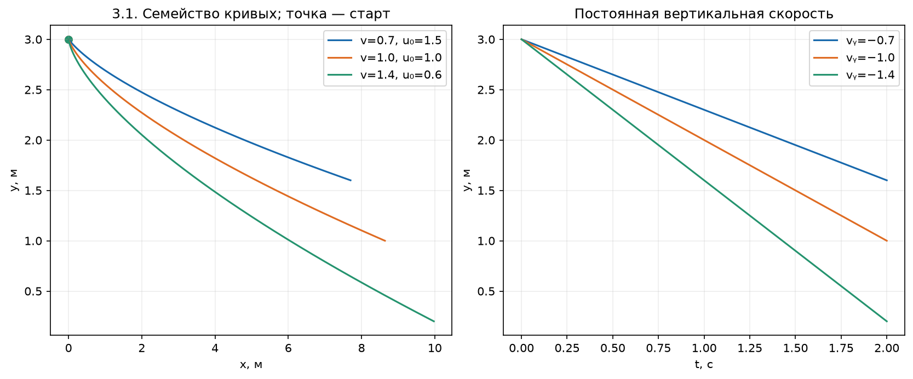
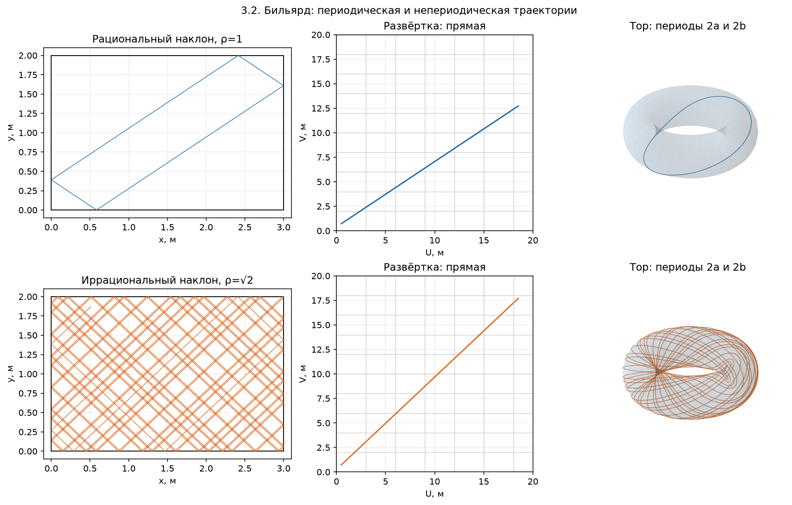
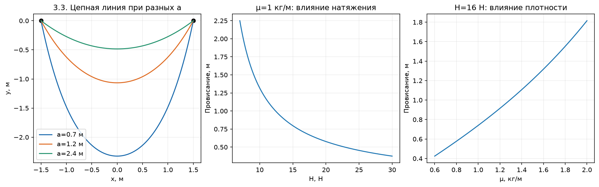
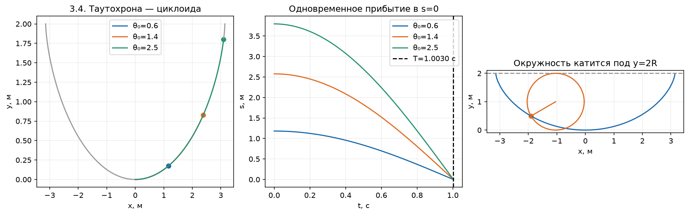
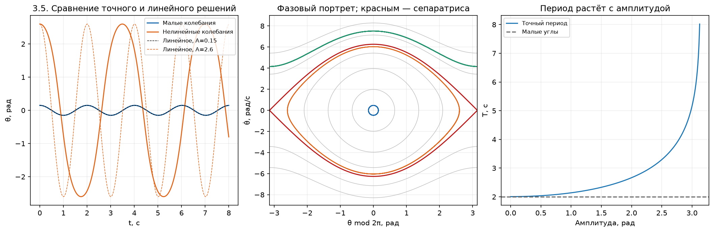

# Практический листок №3

Отдельный проект для VS Code: **[Практические_листок_3.ipynb](Практические_листок_3.ipynb)**.
Все пять задач содержат подробное аналитическое решение в Markdown/LaTeX,
воспроизводимый график PNG и управляемую анимацию FuncAnimation.

## Содержание

| Пункт | Модель | Результат |
|---|---|---|
| 3.1 | Равномерный вертикальный спуск | Полукубическая парабола, y(t)=y₀−vt |
| 3.2 | Бильярд в прямоугольнике | Отражения, развёртка, рациональный/иррациональный поток на торе |
| 3.3 | Подвешенная однородная нить | Цепная линия, натяжение, провисание и равновесие сил |
| 3.4 | Таутохрона | Обращение Абеля, циклоида, одинаковое время спуска |
| 3.5 | Математический маятник | Малые/большие колебания, вращения, сепаратриса, эллиптический период |

## Открыть и запустить

1. Откройте `practice-sheet-3.code-workspace` в VS Code.
2. Откройте ноутбук. Выберите Python из локальной `.venv` через **Select Kernel**.
3. Нажмите **Run All**. Под анимациями есть кнопки запуска, остановки, выбора скорости и ползунок кадров.
4. Отдельные анимации доступны в `animations/3_1.html` ... `animations/3_5.html`.
   Для просмотра откройте `animations/index.html` в браузере на компьютере.

Сохранённые ответы и графики уже находятся в ноутбуке. Для пересчёта нужен Python 3.13
с пакетами из `requirements.txt`; расширения Python и Jupyter рекомендованы workspace-файлом.

## Установка на другом компьютере (PowerShell)

```powershell
py -3.13 -m venv .venv
.\.venv\Scripts\python.exe -m pip install -r requirements.txt
.\.venv\Scripts\python.exe -m ipykernel install --user --name practice-sheet-3 --display-name "Python (Листок 3)"
```

Все основные версии пакетов зафиксированы. Окружение `.venv` создаётся локально и не входит в Git.

## Воспроизводимость

- `theory.md` - исходный текст подробных аналитических решений.
- `models.py` - вычисления, статические графики и пять `FuncAnimation`.
- `checks.py` - проверки уравнений, энергии, отражений и времени спуска.
- `build_notebook.py` - сборка ноутбука из исходников и полное выполнение.
- `figures/` - пять статических PNG.
- `animations/` - пять автономных HTML с кадрами и управлением.
- `live.py` - дополнительное окно Matplotlib с кнопкой Пауза/Пуск на `matplotlib.widgets.Button`.

```powershell
# Проверки моделей
.\.venv\Scripts\python.exe checks.py
# Полная сборка и выполнение: перезаписывает ноутбук из theory.md и Python-модулей
.\.venv\Scripts\python.exe build_notebook.py --execute
# Необязательное отдельное окно: номер задачи от 1 до 5
.\.venv\Scripts\python.exe live.py 1
```

При редактировании аналитических решений меняйте `theory.md`, чтобы повторная
сборка сохранила правки. Готовый ноутбук можно также редактировать отдельно,
но последующая сборка заменит его содержимое.

## Физические допущения

Все модели идеальные: трение отсутствует, направляющие гладкие. В задаче 3.1
постоянна вертикальная скорость, как уточнено в PDF; начальная скорость ненулевая.
В задаче 3.2 исключено точное попадание в угол. Эргодичность относится к потоку
фиксированного иррационального направления на развёрнутом торе.

В задаче 3.3 анимация показывает семейство цепей **разной длины** при фиксированных
опорах. Для одной нерастяжимой цепи с фиксированными длиной и опорами форма уже
определена, произвольно варьировать параметр a нельзя. Длина выводится на экран.

В задаче 3.4 шарики пускаются из покоя выше нижней точки и ниже острий циклоиды.
При R=1 м время спуска равно примерно 1.00303334036 с для всех выбранных стартов.
Качение образующей окружности показывает геометрию и не задаёт физическую скорость шариков.

Статические изображения:







## Проверка

Все 12 кодовых ячеек ноутбука выполнены без ошибок. Проверены сохранение энергии,
период бильярда, баланс сил цепи и одинаковое время спуска по циклоиде.
Численное решение маятника совпадает с точной формулой с максимальной ошибкой
менее 5·10⁻¹⁰ рад для выбранных колебательных примеров.

Дополнительно JavaScript анимаций проверяется без сторонних пакетов командой
`node tools/check_controls.cjs`: все 64 кадра каждой модели, пуск, пауза,
обратное воспроизведение, ползунок и изменение скорости. Node.js нужен только
для этой дополнительной проверки, для просмотра HTML он не требуется.

## Источник

«Практические занятия Листок 3 (2).pdf», П. Е. Рябов, предоставлен пользователем.
Исходный PDF не включён в репозиторий. Дополнительные ссылки для сверки формул
приведены в `theory.md` и в ноутбуке.
